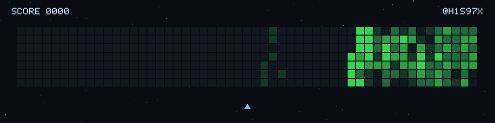
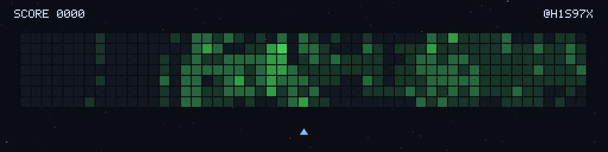
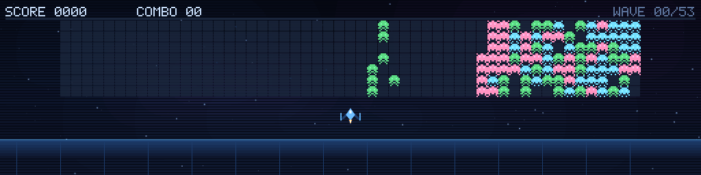
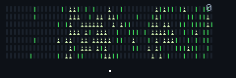

# space-invaders

把贡献日历渲染成一张像素动画 GIF。**平台无关内核、零运行时依赖、代码与玩法全部自研**。

**Platform:** [GitHub Actions](#github-actions) | [CNB](#cnb) | [本地](#本地)

一份镜像只做一件事：`归一化日历 → GIF 文件`，写完退出。
取数放进可插拔 `source`，参数统一为 `CONTRIB_*`，平台差异只在两侧 YAML 与镜像入口的前缀归一里。
主仓是 `cnb.cool/h1s97x/plugins/space-invaders`，GitHub 侧仅是存量 `uses:` 的分发端点。

## 本地

```bash
npm ci
npm run check          # typecheck + 33 个测试 + 参数表一致性
npm run golden         # 重生成黄金帧摘要

CONTRIB_SOURCE=mock CONTRIB_MAX_FRAMES=10 node dist/src/cli/index.js
# → game.gif

# 用归一化日历做输入（零平台）
CONTRIB_SOURCE=file CONTRIB_CALENDAR=examples/calendar.json node dist/src/cli/index.js
```

`npm run check` 会先编译；只做类型检查用 `npm run typecheck`。

## 效果图

两种渲染器通过 `CONTRIB_RENDERER` 切换，都能吃任意数据源。下面是真实数据、
默认参数生成的 **1024×256 完整动画**（不是 10 帧冒烟版；CNB 数据取自 2026-11-13）。
两者节奏不同（`classic` 按 legacy 比例、`invader` 弹道更短）；飞船都是多帧匀速滑行，
两者都允许多颗子弹同时在飞。

### `classic` · 贡献绿方块方阵（legacy 比例节奏）

只留极淡深空渐变、四档绿方块（每次命中退化一档）、Galaga 风小飞船、
黄色胶囊子弹与命中爆炸；不画星点、分数与署名 HUD。

**CNB 活跃日历** — 99 个目标 / 849 帧



**GitHub 贡献日历** — 221 个目标 / 3081 帧



### `invader`（默认）· 像素外星人

8×8 三型两帧精灵按列错峰波浪、极淡深空渐变、逐帧飞行的子弹与命中爆炸；
飞船与背景同 `classic`，不画 HUD、网格、星点、光带与滚动线等装饰。

**CNB 活跃日历** — 99 个目标 / 761 帧



**GitHub 贡献日历** — 221 个目标 / 2619 帧



静态预览：classic [CNB](docs/assets/classic-cnb.png) · [GitHub](docs/assets/classic-github.png)；
invader [CNB](docs/assets/contrib-cnb.png) · [GitHub](docs/assets/contrib-github.png)。
四张 GIF 为文档展示资产，不参与构建与镜像分发。

## 参数（由 `src/cli/args.ts` 自动生成，勿手改）

<!--options-->

| 环境变量 | 类型 | 默认 | 取值 | 说明 |
|---|---|---|---|---|
| `CONTRIB_SOURCE` | string | `mock` | github \| cnb \| file \| mock | 数据源 id，显式指定，内核不做平台探测 |
| `CONTRIB_USER` | string | `` | string | 目标用户名；file / mock 可为空 |
| `CONTRIB_TOKEN` | string | `` | string | 访问令牌，由平台流水线注入 |
| `CONTRIB_ENDPOINT` | string | `` | string | 可选 API 基址覆盖 |
| `CONTRIB_CALENDAR` | string | `` | string | file 源读取的归一化日历路径 |
| `CONTRIB_OUTPUT` | string | `game.gif` | string | 唯一产物路径 |
| `CONTRIB_SEED` | number | `1` | 0..2147483647 | 固定随机种子 |
| `CONTRIB_FPS` | number | `20` | 10..50 | 播放帧率 |
| `CONTRIB_SCALE` | number | `1` | 1..8 | 整数倍放大（画布已够大，默认不放大） |
| `CONTRIB_WIDTH` | number | `1024` | 32..2048 | 低分辨率画布宽（放大前，53 列 × 16px 全览） |
| `CONTRIB_HEIGHT` | number | `256` | 16..1024 | 低分辨率画布高（放大前，含顶部留白与飞船区） |
| `CONTRIB_MAX_FRAMES` | number | `4800` | 1..20000 | 帧数硬上界 |
| `CONTRIB_RULE` | string | `shuffle` | string | 规则注册表 id；shuffle＝按 seed 洗牌（默认），spread＝中心扩散，waves＝逐列 |
| `CONTRIB_RENDERER` | string | `invader` | invader \| classic | 渲染注册表 id；invader＝像素外星人，classic＝贡献绿方块方阵 |

<!--/options-->

完整契约见 [docs/02-contract.md](docs/02-contract.md)。非法值一律报错并列出可选值，不静默回落。

## GitHub Actions

```yaml
- uses: h1s97x/space-invaders@v0.1.0
  with:
    source: github
    output: game.gif
```

完整示例：[examples/pipelines/github-actions.yml](examples/pipelines/github-actions.yml)。
`action.yml` 是 container action，用 `runs.env` 把 inputs 映射成 `CONTRIB_*`；产物只是一个文件，
提交与上传由你的工作流负责。

## CNB

```yaml
- name: shooter
  image: docker.cnb.cool/h1s97x/plugins/space-invaders:latest
  settings:
    source: cnb
    user: h1s97x
    token: ${CNB_TOKEN}
    output: game.gif
```

完整示例：[examples/pipelines/cnb.yml](examples/pipelines/cnb.yml)。
插件规范注入的 `PLUGIN_*` 由镜像内 `entrypoint.sh` 无脑改名成 `CONTRIB_*`，不含平台判断。

## 架构

```text
CONTRIB_* / calendar.json → sources/ → Calendar → domain/ → Level + Action[]
                                                    ↓
                                     render/ → Frame → codec → GIF 文件
```

- `sources/`：唯一允许知道平台的一层，现有 `github` / `cnb` / `file` / `mock`。
- `domain/`：自研「波次 + 热度 + 连击」规则，纯函数、零 IO、seed 可复现。
- `render/`：自绘点阵精灵、自研光栅化与 GIF89a/LZW 编码，无第三方运行时库。
- `contract/`：层间唯一数据模型，不含任何平台字段名。

加平台、加渲染器、改玩法分别动哪些文件，见 [docs/03-extending.md](docs/03-extending.md)。

## 文档

| 文档 | 用途 |
|---|---|
| [01 架构](docs/01-architecture.md) | 五层与依赖方向、编解码约定 |
| [02 契约](docs/02-contract.md) | `CONTRIB_*` 全量清单、`Calendar` schema、输出约定 |
| [03 扩展](docs/03-extending.md) | 加平台 / 加渲染器 / 改规则 |
| [04 重写档案](docs/04-rewrite-record.md) | 零代码继承的可核验证据 |
| [05 迁移](docs/05-migration.md) | 两个旧仓的参数映射与归档顺序 |
| [ADR 0000](docs/adr/0000-rewrite-baseline.md) | 决策与执行计划基线（改动前先读） |

## 归属与许可

MIT，Copyright (c) 2026 h1s97x，见 [LICENSE](LICENSE)。
玩法规则、几何、配色、光栅化与 GIF 编码器均为本项目自行实现，未继承任何上游代码；
来源与核验见 [NOTICE](NOTICE) 和 [04 重写档案](docs/04-rewrite-record.md)。
