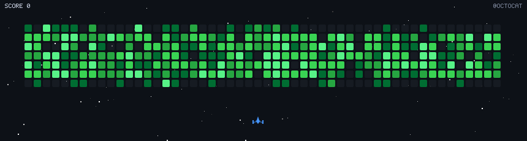

# gh-space-invaders

把 GitHub 贡献图射成 GIF 的**像素轰炸游戏**。TypeScript 实现 Node 22。



## 快速开始

```bash
npm install
npm run build                # 编译到 dist/
npm test                # 32 个单元测试
npm run check                   # build + test 一起跑

npm run offline                      # 假数据 → game.gif
npm run offline -- -o out.gif -s column --fps 40
node dist/index.js --user h1s97x     # 真数据（需 GITHUB_TOKEN）
npm run dev -- --offline             # tsx 直跑，不编译
```

| 参数 | 说明 |
|---|---|
| `-o, --output` | 输出 GIF（默认 `game.gif`） |
| `-s, --strategy` | `random`（默认）/ `column` / `row` / `chaos` |
| `--fps` | 参考项目默认 `40`；帧时长 = `2000/fps` 毫秒 |
| `--colors` | 调色板颜色数（默认 32） |
| `--seed` | 固定随机种子 |
| `--offline` | 用假数据 |

## 架构

| 文件 | 职责 |
|---|---|
| `src/config.ts` | 全部常量：调色板 / 几何 / 速度 / 时长 |
| `src/types.ts` | `Ship` / `Bullet` / `Enemy` / `Explosion` / `Star` / `Action` |
| `src/engine.ts` | 玩法：策略 + 主循环 + 碰撞 |
| `src/render.ts` | 绘制（Canvas 2D） |
| `src/gif.ts` | GIF 编码（gifenc） |
| `src/data.ts` | GraphQL 抓取 + 离线假数据 |
| `src/font.ts` | 自绘 5×7 点阵字体 |
| `src/rng.ts` | mulberry32 可复现随机 |
| `src/index.ts` | 参数解析 + 串流程 |

## 玩法设计

最初的想法来自一个开源项目：[czl9707/gh-space-shooter](https://github.com/czl9707/gh-space-shooter)——
它把贡献图做成太空射击小游戏，这个点子很好。本项目在它的启发下**重新设计并实现**了
完整玩法，加入了自己的工程取舍：

| 本项目 | 灵感来源 |
|---|---|
| `Ship` / `Bullet` / `Enemy` / `Explosion` | `game/drawables/*.py` |
| 星空 | `game/drawables/starfield.py` |
| `columnStrategy` / `rowStrategy` / `randomStrategy` | `game/strategies/*.py` |
| `iterFrames()` | `Animator._generate_frames()` |
| `canTakeAction()` | `GameState.can_take_action()` |
| `shoot()` / `animate()` | `GameState.shoot()` / `GameState.animate()` |

### 五个决定"手感"的关键点

1. **格坐标，不是像素坐标**。`Enemy.x/y` 与 `Bullet.x` 都是**整数格坐标**，
   只有 `Bullet.y` 是浮点。所以命中判定就是 `enemy.x === bullet.x && e.y >= b.y`
   ——子弹**永远不会横向打偏**，"打空"这个概念根本不存在。
2. **开火时机由「停稳」决定**，不是定时器：`canTakeAction() = 不在移动中 and 冷却好了`。
   主循环是 `moveTo(action.x)` → `while (!canTakeAction()) { animate; render }` → `shoot()`。
3. **飞船匀速 12.5 格/秒**，`min()` 夹住绝不越过（`Ship.animate`）。**没有**加速度、
   过冲、转向停顿。
4. **默认策略是 `random`**（照抄参考 `cli.py`）。取**最近的 8 个有目标的列**，
   按 `同列10 / 1~3列100 / 4列以上1` 加权随机挑一个（那个 `1` 就是"意外感"的来源），
   再打那一列**最下面**的敌人。
   别改成 `column` —— `ColumnStrategy` 是"从第 0 周扫到第 51 周"，一排一排推过去，
   那是最机械的观感（实测清场顺序 0,1,2,3,4,5… 单调递增）。
5. **`delta_time = 3.0 / fps`**（`animator.py:41`）。注意这**不是** `1/fps`，是它的 3 倍，
   等于给所有速度乘了 1.5 倍系数；帧时长也是 `1000*2 // fps`。
   这两个都是参考自己的节奏设定，这里**原样照抄**、不"修正"。

### 在此基础上我们做的改进

- **`RowStrategy` 是快照式发弹**（`for _ in range(enemy.health)` 用的是当时的血量快照），
  子弹串格/打空就会少发 → 有时**剩最后1 个活靶没人打**。所以在 `force_kill` 收尾之后补了
  一段「压着最低的活靶继续打」，把参考 `while not is_complete()` 的意图补完整。
- **贡献分档**：参考直接用 GitHub API 返回的 `level`（0~4）当血量；我们 `data.ts` 拿的是
  原始贡献数（0~40），所以这里补了**按分位数分档**，否则会出现 hp40 这种值。

### 实测（离线假数据 `@octocat`，seed=1，`fps=40` → 50ms/帧）

| 策略 | 帧数 | 时长 | 清场 | 发弹 |
|---|---|---|---|---|
| random（默认） | 2661 | 133s | 269/269 | 699 |
| column | 1983 | 99s | 269/269 | 648 |
| row | 2184 | 109s | 269/269 | 653 |
| chaos | 5600 | 280s | 269/269 | 677 |

> `chaos` 是额外的第四种（优先打等级最高的格子），参考只有 column/row/random 三种。

## 技术栈

- **Node 22** + TypeScript（ESM）
- **@napi-rs/canvas** —— 预编译二进制渲染，**不需要**装 cairo（比 node-canvas 省事）
- **gifenc** —— 纯 JS GIF 编码

### gifenc 的坑（都已在代码注释里标注）

- gifenc 是 CJS，Node ESM 下 `import { GIFEncoder } from 'gifenc'` 会抛
  "does not provide an export named"。必须显式引 `gifenc/dist/gifenc.esm.js`。
- **调色板是 `[r,g,b][]` 子数组数组**，不是扁平字节；`applyPalette` 要求长度 ≤ 256，
  且要**尾部多留一项**当透明索引。
- `applyPalette` 内部 `new Uint32Array(rgba.buffer)` **只看整个 ArrayBuffer**、不看
  byteOffset/byteLength，所以必须传长度精确的 view（`asExactU8`）。
- 脏矩形差分靠**透明索引**实现：把与上一帧完全相同的像素写成透明索引 + `dispose=0`。
  **不要指定 `dispose=2`** —— 那会强制每帧全量编码，体积直接翻倍。

## 测试

```bash
npm test          # node:test + tsx，零额外依赖，3~5 秒
npm run check     # 类型检查 + 测试
```

32 个用例，分 5 组。**重点是回归防护** —— 把开发过程中踩过的每个坑都钉死：

| 坑 | 锁它的测试 |
|---|---|
| `column` 被误设为默认，轨迹变成"从左到右一排一排清" | `random 的清场顺序非单调`、`默认策略是 random` |
| `RowStrategy` 快照式发弹 → 残留活靶打不完 | `四种策略都能把场清空` |
| 策略活锁（17435 帧只开 33 枪 / Python 版直接超时） | `不会死循环`、`都会真正开火` |
| 贡献分档丢失 → 出现 hp40 | `血量只能是 1..4` |
| 先减血再读血量 → `score` 恒为 0 | `score 与击败数成正比` |
| gifenc 调色板/透明槽位处理错 | `GIF89a 头 + 尺寸 + 尾块`、`颜色数被夹在 2..255` |

## CI

- **GitHub Actions**：`.github/workflows/ci.yml` —— Node 22，装依赖 → 类型检查 → 测试 → 离线冒烟出图
- **CNB**：`.cnb.yml`
- **作为 Action 使用**：`action.yml`（`runs.using: node22`，产物为 GIF）

## 仓库文档

| 文档 | 用途 |
|---|---|
| [CONTRIBUTING.md](CONTRIBUTING.md) | 开发环境、提交规范、**改动玩法必读** |
| [SECURITY.md](SECURITY.md) | 安全问题报告渠道与响应承诺 |
| [CODE_OF_CONDUCT.md](CODE_OF_CONDUCT.md) | 行为准则 |
| [CHANGELOG.md](CHANGELOG.md) | 更新日志（含 Python → TypeScript 的破坏性变更） |
| [NOTICE](NOTICE) | 灵感来源与第三方许可声明 |
| [LICENSE](LICENSE) | MIT |

Issue / PR 模板已配置在 `.github/` 下。

## 致谢与许可

本项目采用 **MIT License，Copyright (c) 2026 h1s97x**（见 [LICENSE](LICENSE)）。

### 灵感来源与致谢

玩法思路来自 **[czl9707/gh-space-shooter](https://github.com/czl9707/gh-space-shooter)**
（Copyright (c) 2026 Zane Chen，MIT 许可）—— 感谢 Zane Chen 开源了这个点子。
按 MIT 许可的要求，原项目的版权声明与许可声明完整保留在 [NOTICE](NOTICE) 中。

本项目**并非该项目的复制或逐文件对译**，而是在其启发下用 TypeScript 重新设计实现：

| 维度 | 原项目 | 本项目 |
|---|---|---|
| 语言 / 架构 | Python + PIL | **TypeScript + `@napi-rs/canvas`** |
| 坐标系 | 像素 | **格坐标**；子弹 x 量化为整数列 |
| 渲染 | 每帧全量重绘 | **静态底 + drawImage**，GIF 走**透明索引差分** |
| 数据 | 直接用 API 的 level 0~4 | **按分位数分档** |
| 工程 | — | **离线模式、可复现种子、单元测试、CI** |
| 已知缺陷 | 残留活靶 | **已修**（见上节） |

### 依赖

| 包 | 许可 |
|---|---|
| `@napi-rs/canvas` | MIT |
| `gifenc` | MIT (c) Matt DesLauriers |
| `typescript` | Apache-2.0 (c) Microsoft Corp. |
| `tsx` | MIT (c) Hiroki Osame |

## License

MIT，见 [LICENSE](LICENSE)。第三方声明见 [NOTICE](NOTICE)。
